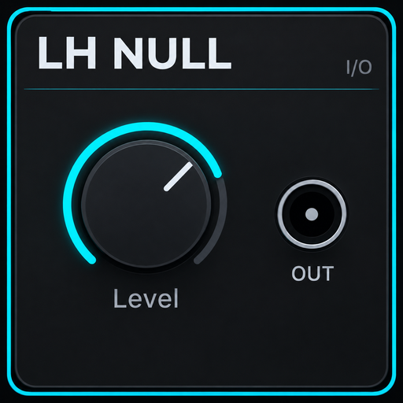
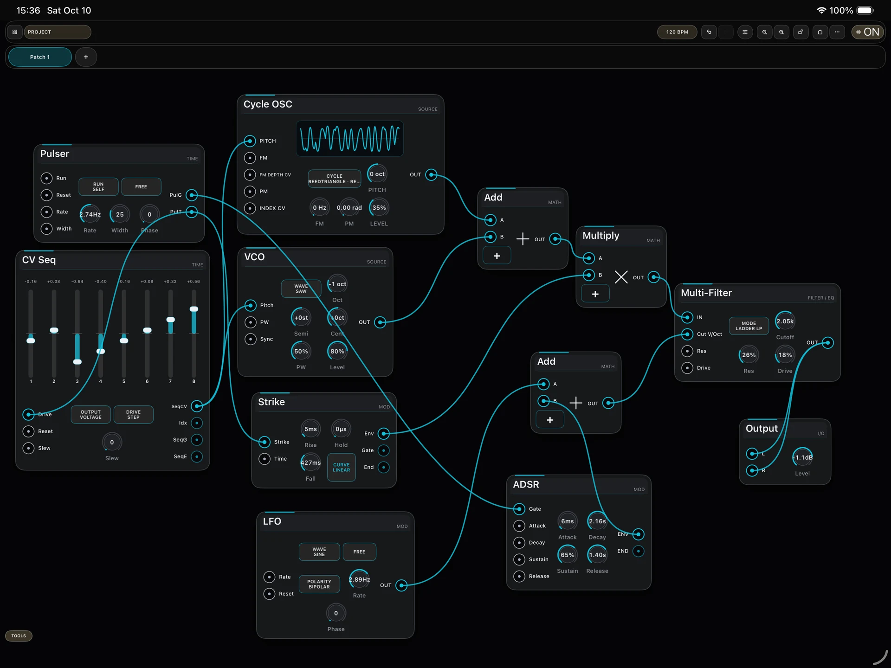
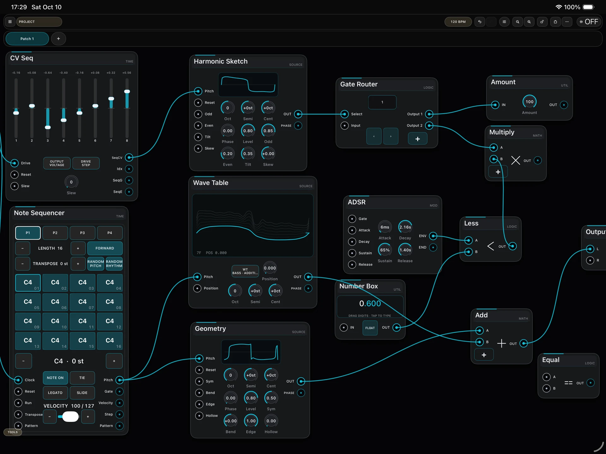
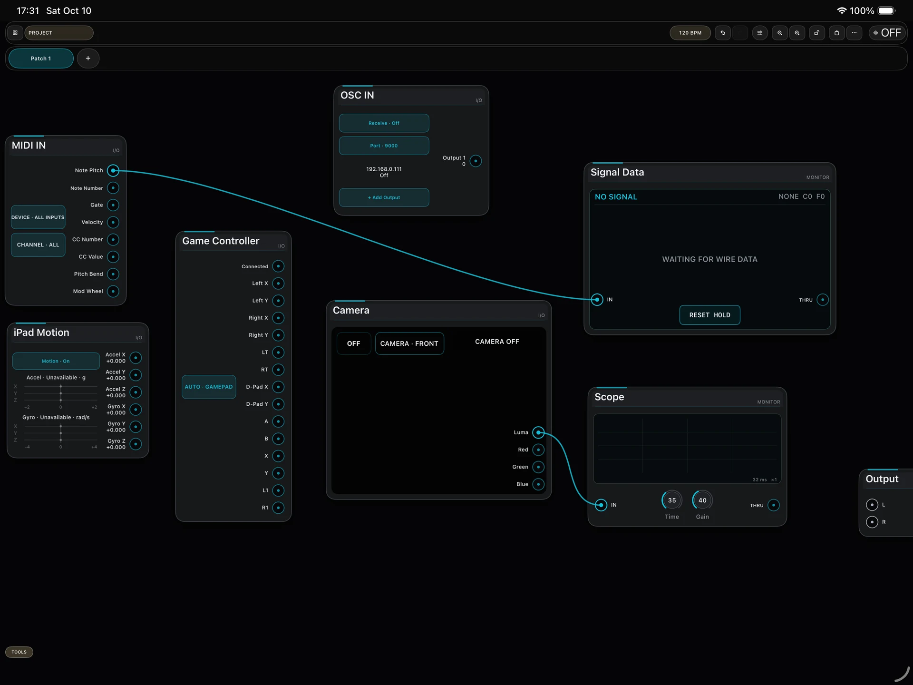
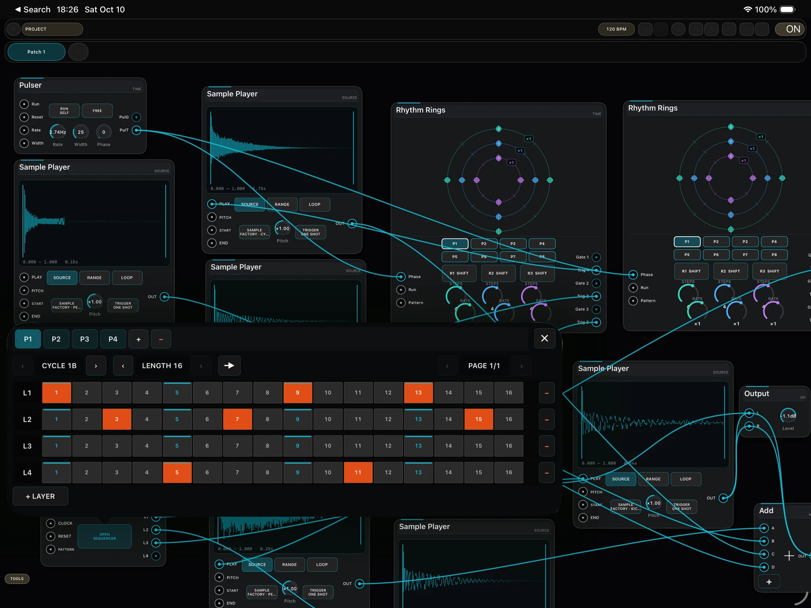

# LH NULL

  

**LH NULL is a modular music creation platform for iPad combining sound synthesis, sequencing, logic, generative structures, and real-time interaction.**

Developed by ** Hao Liu / 刘昊**.

- **Official product page:** https://liuhao-art.com/apps/lh-null
- **App Store:** https://apps.apple.com/app/id6821305517
- **Developer website:** https://liuhao-art.com

## Sound Design

Build sound from source to output inside a modular Patch. LH NULL includes analog-style oscillators, wavetable and single-cycle waveforms, samples, noise, subtractive synthesis, FM, phase modulation, phase distortion, waveform shaping, filters, envelopes, dynamics, and audio effects.

It can be used to construct multi-voice instruments, drums and percussion, custom effects, and larger modular sound systems.

  

## Sequencing, Logic, and Generative Structures

LH NULL combines Note, Step, and CV sequencing with Rhythm Rings, independent clocks, BPM synchronization, mathematical operations, conditions, routing, counters, probability, randomness, LFOs, Phasor, and looping envelopes.

These modules can be combined to create systems that develop over time, from precisely arranged electronic music to evolving generative structures.

  

## Real-World Interaction

External signals can become part of a Patch:

- MIDI notes, velocity, controllers, pitch bend, and modulation data
- OSC communication with external software and devices
- Gamepad sticks, D-pad, triggers, and buttons
- iPad accelerometer and gyroscope data
- Camera brightness and RGB color changes

These inputs can drive sound parameters, logic, sequences, and events.

  

## Reusable Systems

A Project can contain multiple Patches and pass audio, control, and event signals between them. Module structures can be saved as Reusable Patches with user-defined inputs and outputs, allowing instruments, effects, and logic systems to become reusable building blocks.

## Modular Music Creation on iPad

LH NULL provides a visual canvas, module library, Inspector, undo/redo, Scope and signal monitoring, Project and asset management, imported sounds, Demo Projects, interface themes, configurable audio buffer and control rate, and an adjustable A4 tuning reference.

  

## Official Links

- Product page: https://liuhao-art.com/apps/lh-null
- App Store: https://apps.apple.com/app/id6821305517
- Hao Liu / 刘昊: https://liuhao-art.com
- GitHub profile: https://github.com/live-a11y

## Repository Scope

This repository contains **public product information and media for LH NULL**. The LH NULL application source code is **not published in this repository**.

© Hao Liu. Product names, images, and media are provided here for product documentation and reference.
